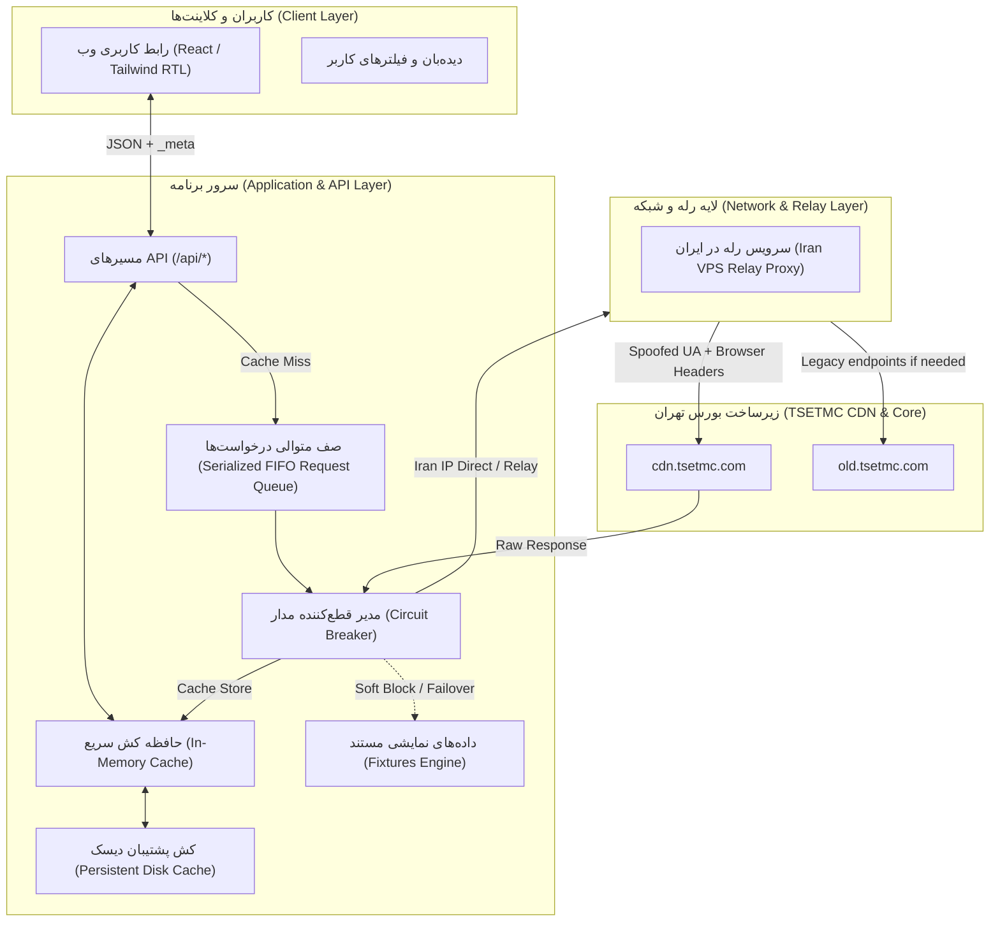
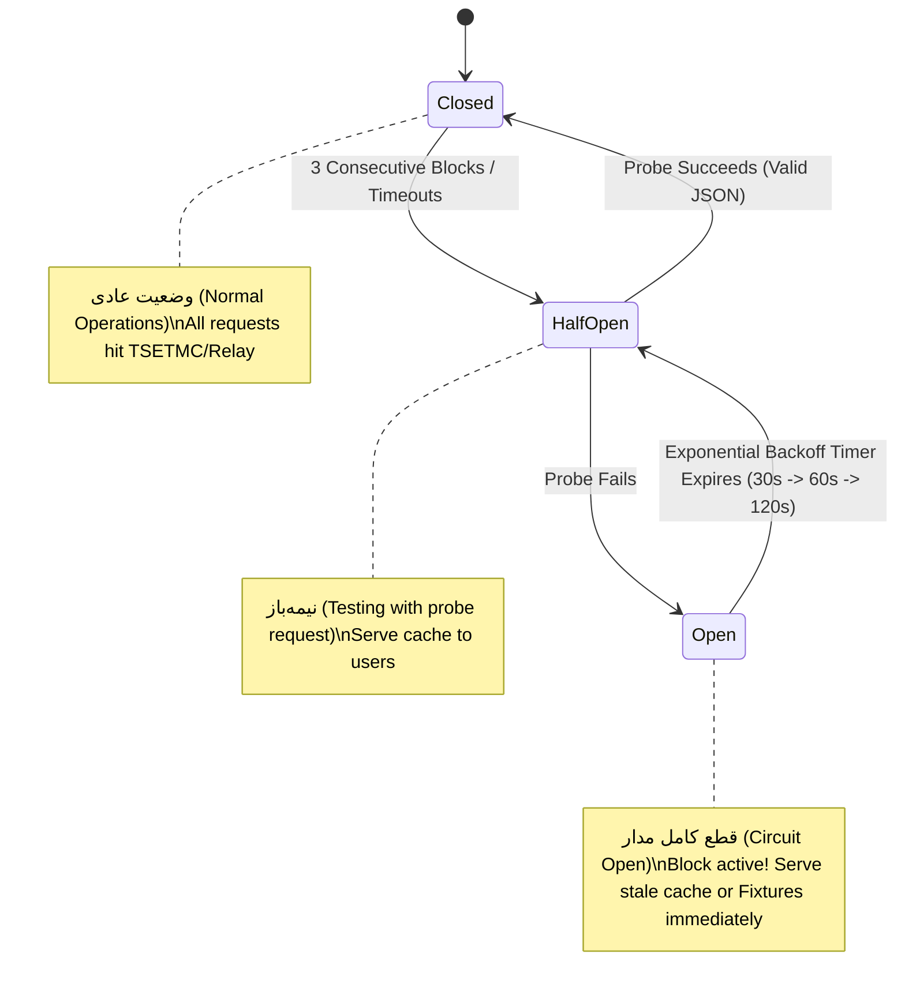

# TSETMC Live Architecture & Data Pipeline Documentation

This document describes the financial data architecture, Iranian IP relay pattern, rate-limiting budget, circuit-breaker state machine, and caching topology for **TSETMC Live (سامانه تحلیل و داده‌های لحظه‌ای بورس تهران)**.

---

## 1. System Topology & Mermaid Diagram

---

## 2. The Geographic Reality & The Relay Pattern

### 2.1 The Problem
TSETMC (`cdn.tsetmc.com` and `old.tsetmc.com`) enforces strict geo-blocking. Requests originating from IP addresses outside the Islamic Republic of Iran (including AWS, GCP, Cloudflare, DigitalOcean, Hetzner, etc.) receive HTTP 403 Forbidden, connection resets, or HTML CAPTCHA/blocking pages.

### 2.2 The Relay Strategy
When hosting outside Iran (such as in container cloud platforms like Cloud Run or Kubernetes):
1. An environment variable `RELAY_URL` is configured (e.g., `https://relay.your-iran-vps.ir/api/tsetmc`).
2. All outbound requests from the backend TSETMC Client route through this relay endpoint instead of directly calling `cdn.tsetmc.com`.
3. The relay service (provided in `/relay`) is a lightweight proxy running on an Iranian VPS (Asiatech, Shatel, Afranet, Mobinnet, ParsOnline).
4. The relay adds authorization token headers (`X-Relay-Token`), sets canonical browser User-Agents, and returns the pure upstream response with streaming gzip compression.
5. If `RELAY_URL` is omitted and the server detects it is running inside Iran, direct calls are executed.
6. If both direct and relay calls encounter blocks or network disconnects, the system gracefully falls back to **Fixtures Mode** with the `demo: true` badge visible to the user.

---

## 3. Rate-Limit Budget & Serialized Queue

### 3.1 Rate Budget Calculation
TSETMC's rate limiter allows roughly **15 to 25 requests per minute per IP** before triggering temporary IP throttling or captcha challenges. Exceeding 1 request per 2 seconds will rapidly result in HTTP 429 or silent soft-blocks.

| Period | Target Calls / Minute | Request Interval | Strategy |
| :--- | :--- | :--- | :--- |
| **Market Hours (09:00 - 12:30)** | 10 - 12 calls/min | 5 - 6 seconds | Single consolidated Market Watch poll + cached symbol lookups |
| **Pre-Opening (08:45 - 09:00)** | 6 - 8 calls/min | 8 - 10 seconds | Order book depth priority |
| **Off Hours & Weekends** | 1 - 2 calls/min | 30 - 60 seconds | Serve cold cached data, minimize upstream traffic |

### 3.2 Serialized Request Queue (`SerializedQueue`)
Outbound requests to TSETMC are NEVER executed in parallel from the same backend instance. All outbound requests join a FIFO priority queue with an inter-request delay of $\ge 1200\text{ms}$. If multiple user sessions request quotes for symbol $A$ and symbol $B$, the queue ensures:
1. Identical in-flight requests are collapsed (Request Deduplication / Single-Flight).
2. Different requests are spaced at safe intervals.
3. Market Watch snapshot is prioritized over secondary historical queries.

---

## 4. Soft-Block Detection & Circuit Breaker State Machine

### 4.1 Soft-Block Signatures
TSETMC often does not return HTTP 403 or 429 directly; instead, it returns **HTTP 200 with an HTML error page** or Persian text indicating a block. The resilience layer tests every response for:
- Non-JSON content-type when JSON was requested.
- Presence of Persian strings: `مسدود`, `دسترسی غیرمجاز`, `خطای سرور`, `تعداد درخواست بیش از حد`, `کپچا`.
- Empty response or HTML `<!DOCTYPE html>`.

### 4.2 State Machine

---

## 5. Caching Key Strategy & TTL Matrix

| Data Domain | Cache Key Format | In-Market TTL | Off-Hours TTL | Storage Engine |
| :--- | :--- | :--- | :--- | :--- |
| **Market Watch (همه نمادها)** | `tsetmc:mw:all` | 5 – 10 seconds | 60 seconds | In-Memory (LRU) + Disk |
| **Index Overview (شاخص‌ها)** | `tsetmc:indices:all` | 15 seconds | 120 seconds | In-Memory |
| **Symbol Quote (جزئیات نماد)** | `tsetmc:quote:{insCode}` | 3 – 5 seconds | 60 seconds | In-Memory |
| **Order Book (عمق ۵ تایی)** | `tsetmc:ob:{insCode}` | 2 – 3 seconds | 60 seconds | In-Memory |
| **Client Type (حقیقی-حقوقی)**| `tsetmc:ct:{insCode}` | 10 seconds | 300 seconds | In-Memory |
| **Daily History (سابقه روزانه)**| `tsetmc:hist:{insCode}` | 3600 seconds | 14400 seconds | Disk / In-Memory |
| **Sectors (اطلاعات صنایع)** | `tsetmc:sectors:summary` | 30 seconds | 300 seconds | In-Memory |

---

## 6. Failure Modes & Graceful Degradation

1. **TSETMC Soft-Block / IP Ban**:
   - Return last-known-good cached payload immediately.
   - Header `_meta.cached = true` and `_meta.stale = true`.
   - UI shows yellow status badge: `ارتباط با بورس موقتاً محدود است؛ در حال نمایش آخرین اطلاعات دریافت شده`.
2. **First Boot with Foreign IP & No Relay**:
   - Backend auto-detects unreachability.
   - Switches to Fixtures mode (`_meta.demo = true`, `_meta.source = "fixture"`).
   - UI displays banner: `داده نمایشی (Demo Data) — برای اتصال مستقیم آی‌پی ایران یا رله لازم است`.
3. **Partial Endpoint Failure**:
   - If `/orderbook` fails but `/symbol` works, the symbol header loads normally while the order book section shows a fallback notice with cached depth.
